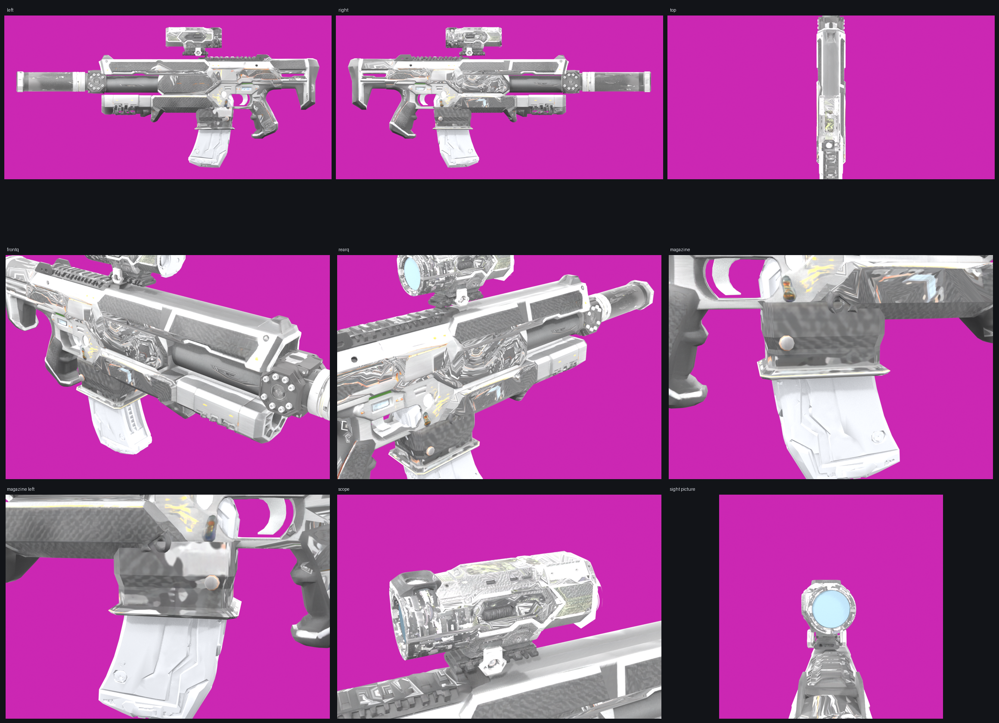
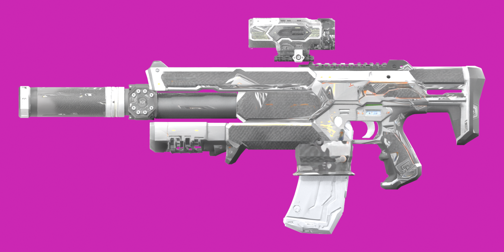
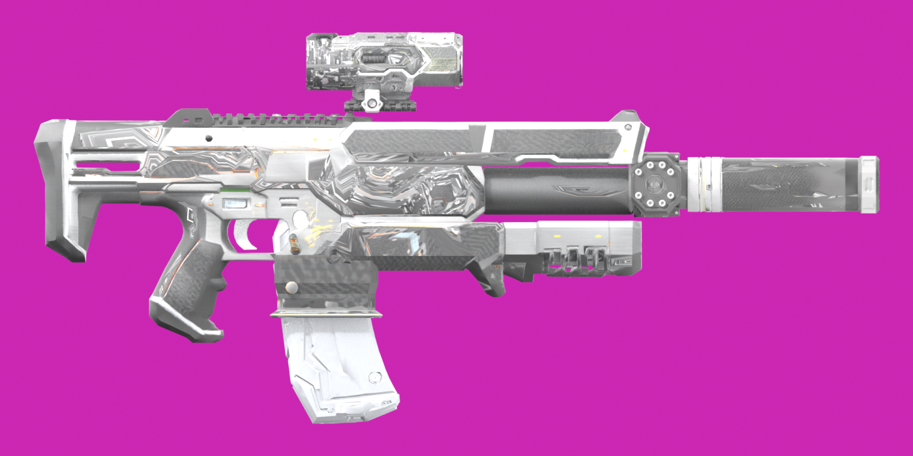
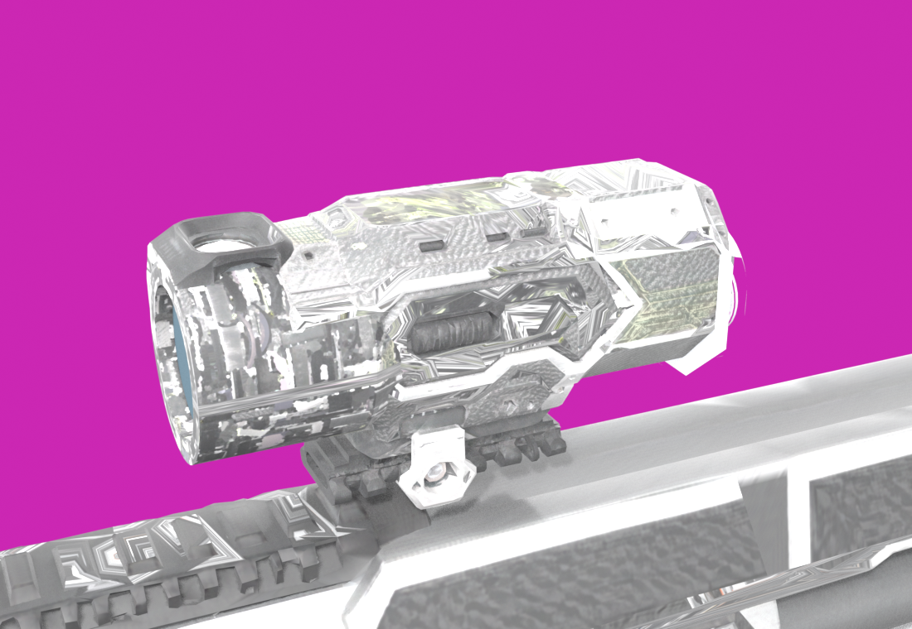
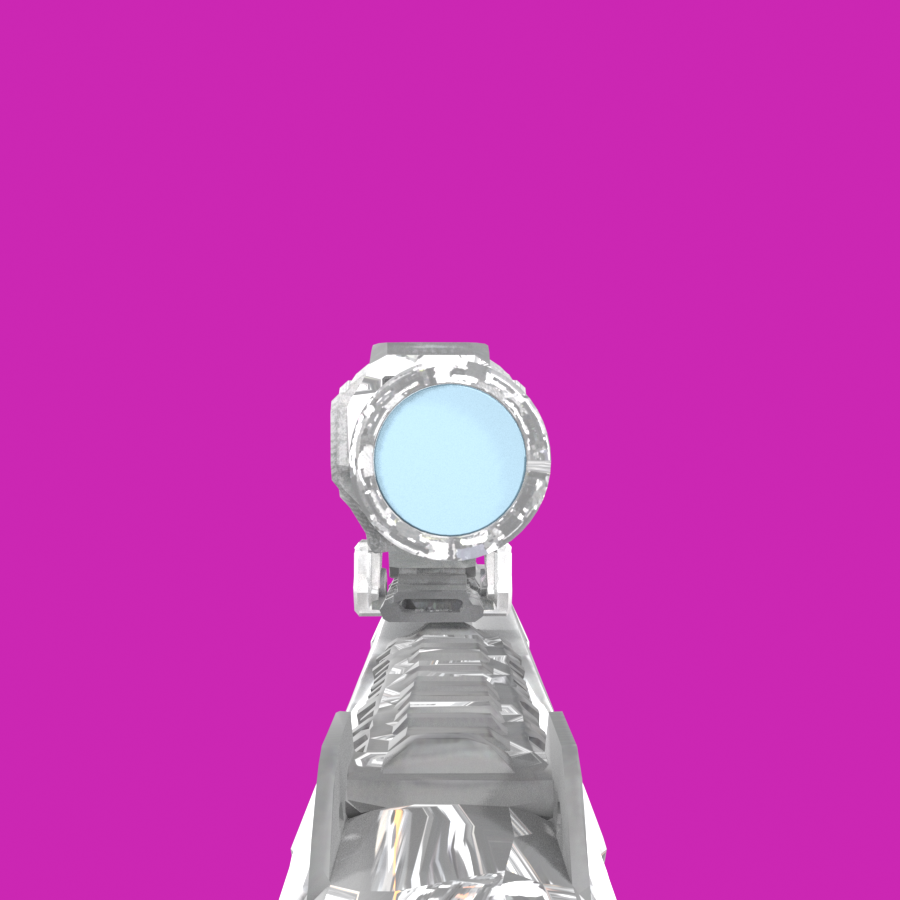
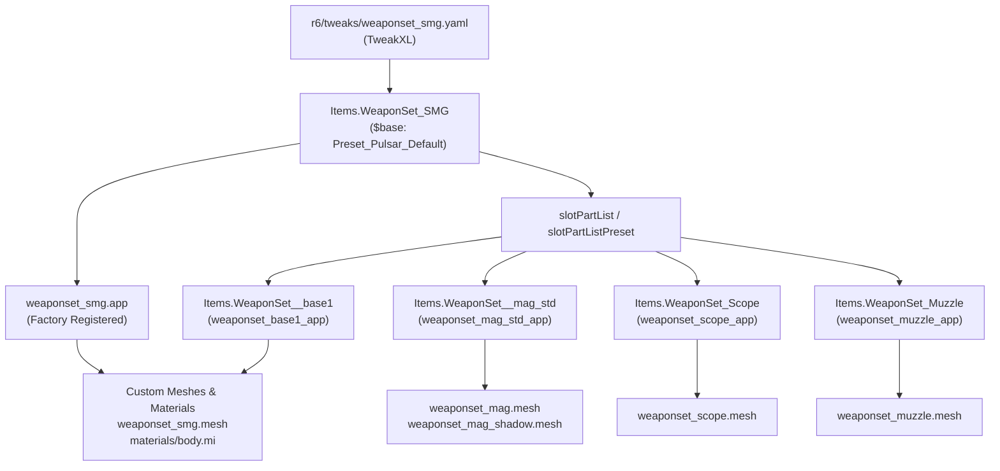

# Boogu DS-X — Custom Bullpup Power SMG for Cyberpunk 2077

[](https://www.cyberpunk.net/)
[](https://www.cyberpunk.net/phantom-liberty)
[](#current-status--future-roadmap)
[](https://github.com/psiberx/cp2077-archive-xl)
[](https://github.com/psiberx/cp2077-tweak-xl)
[](LICENSE)

> [!WARNING]
> **Project Status: Work In Progress (WIP) — Currently Paused / Not in Active Development**
>
> The **Boogu DS-X** is an original custom Power Submachine Gun mod with dedicated modular attachments (optic, suppressor, extended magazine) and custom inventory icons. **Active development is currently on pause.** 
> 
> The repository is published as a working build and technical reference snapshot containing the ready-to-play compiled mod archive, complete WolvenKit source depot, render previews, diagnostic presets, and automation toolchain.

---

## Visual Showcase



<p align="center">
  
  
</p>

<p align="center">
  
  
</p>

---

## Table of Contents

- [Overview & Lore](#overview--lore)
- [Weapon & Attachment Specifications](#weapon--attachment-specifications)
- [How to Obtain & Spawn Commands](#how-to-obtain--spawn-commands)
- [Key Features](#key-features)
- [Requirements & Dependencies](#requirements--dependencies)
- [Installation Guide](#installation-guide)
  - [Manual Installation](#manual-installation)
  - [Mod Manager (Vortex / MO2)](#mod-manager-vortex--mo2)
  - [Verification](#verification)
  - [Uninstallation](#uninstallation)
- [Technical Architecture & Solved Engine Pitfalls](#technical-architecture--solved-engine-pitfalls)
  - [1. The Part Entity Reassembly Bug](#1-the-part-entity-reassembly-bug)
  - [2. Preserving Generic Weapon Mod Slots](#2-preserving-generic-weapon-mod-slots)
  - [3. Legendary Generation Freeze Resolution](#3-legendary-generation-freeze-resolution)
  - [4. Mesh Vertex Overflow & Buffer Integrity](#4-mesh-vertex-overflow--buffer-integrity)
- [Diagnostic Ladder & Bisect Methodology](#diagnostic-ladder--bisect-methodology)
- [Development Toolchain & Automation](#development-toolchain--automation)
  - [Directory Layout](#directory-layout)
  - [Hot-Reload Workflow](#hot-reload-workflow)
- [Current Status & Future Roadmap](#current-status--future-roadmap)
- [Credits & Acknowledgments](#credits--acknowledgments)

---

## Overview & Lore

The **Boogu DS-X** is an unregistered, highly modified custom bullpup power submachine gun crafted on a Darra Polytechnic DS1 Pulsar base:

> *"A one-off build on a Darra Polytechnic DS1 frame: carbon-composite shell, reworked optics rail and a hand-wired power cell. Unregistered, unlicensed and very loud."*

While inheriting the refined animations, rig, and recoil handling of the vanilla Pulsar, the DS-X introduces:
- A lightweight **carbon-composite chassis** with distinct high-tech matte and reflective PBR surfaces.
- Custom **hand-wired internal battery pack** powering an accelerated cyclic rate.
- Matched **modular attachment suite**: the **DS-X Optic** and **DS-X Suppressor**, engineered to attach seamlessly to any compatible rail in Night City.
- Custom-sculpted **extended magazine** featuring high-definition baseplates and an authored shadow mesh to eliminate ambient occlusion clipping.

---

## Weapon & Attachment Specifications

| Item Record | Display Name | Type | Description |
|---|---|---|---|
| `Items.WeaponSet_SMG` | **Boogu DS-X** | Legendary Power SMG | Base bullpup submachine gun with custom frame and rail |
| `Items.WeaponSet_Scope` | **DS-X Optic** | Long Scope Attachment | Matched carbon-shell sight; fits any long scope rail |
| `Items.WeaponSet_Muzzle` | **DS-X Suppressor** | Power Muzzle Attachment | Matched carbon-shell can; fits any power barrel |
| `Items.WeaponSet__mag_std` | **DS-X Standard Mag** | Magazine Part Item | Standard capacity carbon-composite magazine |
| `Items.WeaponSet__mag_stdr` | **DS-X Extended Mag** | Magazine Part Item | Extended capacity carbon-composite magazine |

### Modding Capabilities
Unlike vanilla Iconic weapons which lock modding strictly to iconic perks, the Boogu DS-X retains **two full generic weapon mod slots** (`Base_Power_AR_SMG_LMG_Blueprint`), enabling players to equip:
- Damage enhancers (e.g., Pyro, Supercharger, Overcharge)
- Handling, stability, and magazine augmentations
- Standard scopes and muzzles across all manufacturer lines

---

## How to Obtain & Spawn Commands

The items are added to your inventory via the **Cyber Engine Tweaks (CET)** console. 

Open the CET console (default key: `~` or chosen binding) and enter each command on its own line:

```lua
Game.GetTransactionSystem():GiveItem(Game.GetPlayer(), ItemID.FromTDBID("Items.WeaponSet_SMG"), 1)
Game.GetTransactionSystem():GiveItem(Game.GetPlayer(), ItemID.FromTDBID("Items.WeaponSet_Scope"), 1)
Game.GetTransactionSystem():GiveItem(Game.GetPlayer(), ItemID.FromTDBID("Items.WeaponSet_Muzzle"), 1)
```

> [!NOTE]
> The weapon spawns by default with the matched **DS-X Optic** and **DS-X Suppressor** pre-installed. Additional copies of the attachments can be spawned into your backpack for use on other compatible firearms.

---

## Key Features

- **Native ArchiveXL Integration**: Uses `weaponset_factory.csv` for modular `.app` and `.mesh` resource loading without overwriting vanilla game archives.
- **TweakXL Architecture**: Fully authored declarative TweakDB entries modifying slot presets, stats, visual tags, and localization pointers cleanly.
- **Dedicated Custom Icon Atlas**: Includes high-resolution UI and inventory icon (`weaponset_icon.inkatlas`, `slot_01`) seamlessly integrated into the backpack and equipment screens.
- **Multi-Part Entity Rigging**: Accurately maps the weapon chassis, receiver, and separate magazine entities (`mag_std` / `mag_stdr`) to ensure smooth reloading and bolt animations.
- **Integrated Diagnostic Ladder**: 4 diagnostic presets authored to isolate engine freezes between meshes, slot arrays, and part items.
- **Zero Vanilla Game Overwrites**: Safe to install and uninstall at any time without dirtying game saves.

---

## Requirements & Dependencies

| Dependency | Minimum Version | Required For |
|---|---|---|
| [Cyberpunk 2077](https://www.cyberpunk.net/) | `2.0+` or `2.1+` | Base Game (Phantom Liberty optional) |
| [ArchiveXL](https://github.com/psiberx/cp2077-archive-xl) | `v1.14.0+` | Custom resource factory, meshes, and textures |
| [TweakXL](https://github.com/psiberx/cp2077-tweak-xl) | `v1.8.0+` | Declarative item, slot, and stat definitions |
| [RED4ext](https://github.com/WopsS/RED4ext) | `v1.13.0+` | Script and archive extension loader |
| [Cyber Engine Tweaks](https://github.com/maxime佰/CyberEngineTweaks) | `v1.30.0+` | Console item spawning |
| [RedHotTools](https://github.com/psiberx/cp2077-red-hot-tools) *(Optional)* | Any | Real-time archive hot-reloading during development |

---

## Installation Guide

### Manual Installation

1. Download the latest release package: `boogu-dsx-smg-v0.1.0-wip.zip` from [Releases](https://github.com/0xra0/boogu-dsx-smg/releases).
2. Extract the archive directly into your Cyberpunk 2077 root directory:
   - **GOG**: `C:\Games\Cyberpunk 2077\`
   - **Steam**: `C:\Program Files (x86)\Steam\steamapps\common\Cyberpunk 2077\`
   - **Epic**: `C:\Program Files\Epic Games\Cyberpunk 2077\`
3. Verify that the files are in their target locations:
   - `Cyberpunk 2077/archive/pc/mod/weaponset_smg.archive`
   - `Cyberpunk 2077/archive/pc/mod/weaponset_smg.xl`
   - `Cyberpunk 2077/r6/tweaks/weaponset_smg.yaml`

### Mod Manager (Vortex / MO2)

1. Click **Install From File** in Vortex or Mod Organizer 2.
2. Select `boogu-dsx-smg-v0.1.0-wip.zip`.
3. Enable and deploy the mod.

### Verification

1. Launch Cyberpunk 2077.
2. Load any save game.
3. Open the CET console and spawn the weapon:
   ```lua
   Game.GetTransactionSystem():GiveItem(Game.GetPlayer(), ItemID.FromTDBID("Items.WeaponSet_SMG"), 1)
   ```
4. Open your Inventory (`I`) and confirm the **Boogu DS-X** appears in your weapon slot with its custom name, description, and icon.

### Uninstallation

Delete the installed files from your game directory:
```
archive/pc/mod/weaponset_smg.archive
archive/pc/mod/weaponset_smg.xl
r6/tweaks/weaponset_smg.yaml
```

---

## Technical Architecture & Solved Engine Pitfalls



### 1. The Part Entity Reassembly Bug
In REDengine, weapons are assembled dynamically from part entities. When any attachment (scope or muzzle) is equipped, the engine triggers an entity rebuild of all slots in `slotPartListPreset`. If the base pulsar parts remain in this list, the engine immediately re-renders the stock Pulsar body and magazine over the custom model.

**Resolution**: Both `slotPartList` and `slotPartListPreset` are mutated via TweakXL to explicitly wire our dedicated part items (`Items.WeaponSet__base1`, `Items.WeaponSet__mag_std`, and `Items.WeaponSet__mag_stdr`), ensuring the custom chassis and magazine persist through all attachment states.

### 2. Preserving Generic Weapon Mod Slots
Vanilla iconic weapons assign `Items.Iconic_Ranged_Weapon_Blueprint`, which strips all generic mod slots and locks the weapon to iconic-only perks.

**Resolution**: `blueprint` is left untouched, inheriting `Items.Base_Power_AR_SMG_LMG_Blueprint` from the Pulsar. This gives players two active mod sockets in addition to scope and muzzle slots.

### 3. Legendary Generation Freeze Resolution
When forcing `Quality.Legendary` on spawned items, removing `Items.QualityRandomization` while leaving `Items.ItemPlusRandomizer_MaxQuality` causes an engine hang: `ItemPlusRandomizer` attempts to calculate `+/++` tiers relative to a roll that never occurred.

**Resolution**: All three randomization groups are stripped in lockstep:
```yaml
statModifierGroups:
  - !remove Items.QualityRandomization
  - !remove Items.ItemPlusRandomizer_MaxQuality
  - !remove Items.ItemPlusRandomizer_Below_MaxQuality
```

### 4. Mesh Vertex Overflow & Buffer Integrity
REDengine mesh chunks utilize 16-bit vertex index buffers (`IBCT_IndexUShort`), imposing a hard limit of **65,535 vertices per chunk**. glTF exports split vertices at UV seams and hard normals, causing mesh vertex counts to exceed Blender viewport estimates.

**Resolution**: The project includes `audit_final.py` and `check_meshes.sh` to enforce index buffer ceilings and verify round-trip export through WolvenKit CLI before any archive is compiled.

---

## Diagnostic Ladder & Bisect Methodology

The repository provides a formal 4-rung diagnostic ladder in `weaponset_smg.yaml` to bisect any engine equip hang:

| Rung | Item Record | Configuration | Diagnostic Purpose |
|---|---|---|---|
| **0** | `Items.WeaponSet_Test` | Stock Pulsar clone; no custom assets | Control test. If this freezes, the issue is external to this mod. |
| **1** | `Items.WeaponSet_SMG_A` | Custom `.app`, stock slot arrays | Isolates fault to `weaponset_smg.app` or body geometry. |
| **2** | `Items.WeaponSet_SMG_C` | Custom YAML slot arrays, stock parts | Isolates YAML authoring, `$base` resolution, or inline syntax errors. |
| **3** | `Items.WeaponSet_SMG_B` | Custom parts & body, stock Pulsar attachments | Tests part entity rebuild path without custom attachments. |
| **Target** | `Items.WeaponSet_SMG` | Full production weapon & attachments | Complete mod assembly. |

---

## Development Toolchain & Automation

### Directory Layout

```
.
├── mod/                               # Shipped mod ready for direct installation
│   ├── archive/pc/mod/
│   │   ├── weaponset_smg.archive      # Compiled game archive (38 resources)
│   │   └── weaponset_smg.xl           # ArchiveXL factory & localization registration
│   └── r6/tweaks/
│       └── weaponset_smg.yaml         # TweakXL item definitions and slot wiring
├── depot_v2/                          # WolvenKit raw project depot
│   └── weaponset/smg/                 # Meshes, materials, textures, apps, rigs
├── docs/                              # Technical specifications and guides
│   ├── tech_spec.md                   # Engine architecture and record spec
│   ├── diagnostic_ladder.md           # Bisect guide for equip freezes
│   └── toolchain.md                   # Pipeline scripts and hot-reload guide
├── preview/                           # Render previews and contact sheet
├── models/images/                     # Concept reference images
├── check_meshes.sh                    # Mesh acceptance gate
├── check_refs.py                      # Archive reference integrity checker
└── pack_deploy.sh                     # Automated pack and deploy pipeline
```

### Hot-Reload Workflow

With **RedHotTools** installed, run:
```bash
./pack_deploy.sh hot
```
The archive is delivered to `archive/pc/hot/`, where the engine's `ArchiveWatcher` hot-swaps the archive in memory without closing Cyberpunk 2077. Then run `TweakXL.Reload()` in CET to reload YAML changes instantly.

---

## Current Status & Future Roadmap

### What is Completed & Fully Verified
- [x] Complete custom 3D model geometry for SMG body, standard magazine, extended magazine, optic, and suppressor.
- [x] Authored PBR textures (Diffuse, Normal, Roughness, Metalness) and material instances.
- [x] Hand-authored shadow mesh (`weaponset_mag_shadow.mesh`) eliminating visual artifacts.
- [x] Full ArchiveXL factory registration and TweakXL slot wiring.
- [x] Custom inventory and HUD icon atlas (`weaponset_icon.inkatlas`).
- [x] Onscreen English localization (`en-us.json`).
- [x] Automated mesh validation and archive reference integrity testing.

### Future Roadmap (When Development Resumes)
- [ ] **Custom Audio Firing Profile**: Dedicated Wwise soundbanks for firing, suppressor shot, and reload mechanics via Audioware.
- [ ] **Iconic Weapon Perk Tree**: Custom redscript or TweakDB stat modifiers (e.g., thermal power ricochet, accelerated burst firing).
- [ ] **Vendor & World Drop Integration**: Custom quest placement, ripperdoc/gunsmith vendor distribution in Night City, and world loot drops.
- [ ] **Skin Variations**: High-contrast cyberpunk colorways (Militech Tactical, Arasaka Chrome, Mox Pink/Teal).

---

## Credits & Acknowledgments

- **CD PROJEKT RED** for *Cyberpunk 2077* and *Phantom Liberty*.
- **psiberx** for [ArchiveXL](https://github.com/psiberx/cp2077-archive-xl), [TweakXL](https://github.com/psiberx/cp2077-tweak-xl), [Codeware](https://github.com/psiberx/cp2077-codeware), and [RedHotTools](https://github.com/psiberx/cp2077-red-hot-tools).
- **WolvenKit Team** for the [WolvenKit](https://github.com/WolvenKit/WolvenKit) modding suite and CLI compiler.
- **WopsS** for [RED4ext](https://github.com/WopsS/RED4ext).
- **CET Team** for [Cyber Engine Tweaks](https://github.com/maxime佰/CyberEngineTweaks).
